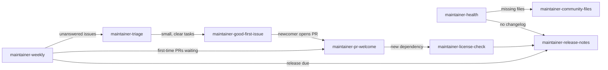

# maintainer-skill

**A co-maintainer for your open-source repo: your issue queue sorted, your releases written, and your first-time contributors welcomed, while you keep the final say.**

 

Maintaining a project people actually use means a second unpaid job. Issues pile up faster than you can read them, half of them are the same bug reported three ways, and the other half are missing the version number. Release day means scrolling through `git log` trying to remember what changed and who deserves credit. A stranger opens their first PR and waits two weeks, and they never come back.

This pack gives Claude Code eight maintainer skills and three focused agents that handle the reading, sorting and drafting. They triage issues and spot duplicates, write the changelog and release notes from your real history, review newcomer PRs in a voice that teaches instead of discourages, check your dependency licenses, write the community files your repo is missing, score repo health, and give you a weekly digest of who is waiting on you.

Everything that would change GitHub (labels, comments, reviews, tags, releases) is drafted first and run only after you say yes. You stay the maintainer. Claude does the reading and drafting.

## What's inside

### Skills

| Skill | What it does |
|---|---|
| `maintainer-triage` | Reads open issues with `gh`, classifies each one (bug, needs-repro, feature, question, duplicate, stale, security), confirms duplicates, and drafts labels plus a short reply per issue. |
| `maintainer-good-first-issue` | Finds small, well-scoped tasks in the code and the tracker and writes starter issues with file pointers, acceptance criteria and a "how to get started" section. |
| `maintainer-release-notes` | Turns `git log <last-tag>..HEAD` and merged PRs into a Keep a Changelog entry, human release notes, contributor credits and a semver bump. |
| `maintainer-pr-welcome` | Reviews a first-time contributor's PR: correctness first, blocking separated from nits, specific and kind, and it explains the repo's conventions as it goes. |
| `maintainer-license-check` | Reads your manifests and lockfiles and flags dependency licenses that conflict with yours, are unknown, or come with conditions. It is a first pass, not legal advice. |
| `maintainer-community-files` | Writes CONTRIBUTING, SECURITY, issue forms, a PR template, a CODEOWNERS suggestion and a code of conduct that links the Contributor Covenant, all using your repo's real commands. |
| `maintainer-health` | Scores the repo out of 100 (README, LICENSE, CI, tests, templates, changelog and more) and lists the fixes in order of how many points each adds. |
| `maintainer-weekly` | A weekly digest of new issues, PRs waiting longest for review, unanswered and stale items, and first-time contributors to thank. |

### Agents

| Agent | Role |
|---|---|
| `triage-captain` | A read-only issue triager. It returns a triage plan and the exact commands, and never runs them. |
| `release-manager` | Runs preflight checks and prepares the changelog, version bumps and notes, then stops before any commit, tag, push or publish. |
| `newcomer-buddy` | A patient reviewer for first-time contributors. It drafts a teaching review and never posts it. |

### Helper scripts (Python 3.9+, standard library only, no network)

| Script | Used by | Does |
|---|---|---|
| `skills/maintainer-triage/dupes.py` | triage | Scores likely duplicate issues from `gh issue list --json` output |
| `skills/maintainer-release-notes/changelog.py` | release notes | Parses conventional and plain commits, groups them, detects breaking changes, suggests the bump |
| `skills/maintainer-license-check/license_compat.py` | license check | Reads manifests, evaluates SPDX expressions, applies a compatibility table, flags conflicts |
| `skills/maintainer-health/health.py` | health | Scores the repo and prints a markdown checklist with fixes |

## Install

In Claude Code:

```
/plugin marketplace add vivekbhange-hub/maintainer-skill
/plugin install maintainer-skill@maintainer-skill
```

Manual install: copy `skills/*` into `~/.claude/skills/` and `agents/*` into `~/.claude/agents/`.

You need the [GitHub CLI](https://cli.github.com) (`gh auth login`) for anything that reads issues or PRs, and Python 3.9+ for the helper scripts.

## Try it in 60 seconds

Open Claude Code in any repo you maintain and say:

```
How healthy is my repo?
```

`maintainer-health` runs `health.py` and reports a score and the fixes. The excerpt below is an **example** from a small demo repo, not a real project:

```
# Repo health: tinyparse

**Score: 57/100 (grade D)**

| [x] | LICENSE file                | 15/15 | LICENSE                  |
| [x] | Continuous integration      | 10/10 | .github/workflows/ci.yml |
| [ ] | CONTRIBUTING guide          |  0/8  | -                        |
| [ ] | SECURITY policy             |  0/8  | -                        |

## Fixes, biggest gain first
- [ ] CONTRIBUTING guide (+8): Add CONTRIBUTING.md with setup, test command, and PR rules
- [ ] SECURITY policy (+8): Add SECURITY.md: supported versions and a private way to report vulnerabilities
- [ ] Changelog (+6): Add CHANGELOG.md in Keep a Changelog format
```

Then try `write the release notes since the last tag`. Here is an **example** changelog entry from the helper for four commits, one of them breaking:

```
## [2.0.0] - 2026-11-07

> Breaking changes in this release:
> - Python 3.9 is now the minimum

### Added
- **cli:** Add --json output (#41)

### Changed
- **BREAKING:** Drop Python 3.8 support (#44)

### Fixed
- Handle empty config file (#42)
```

The dependabot commit is left out of the credits, the bump is explained (`major: at least one breaking change`), and nothing is tagged until you approve.

Other phrases that work: `triage my issues`, `which issues are duplicates`, `review PR #212 from a new contributor`, `check my dependency licenses`, `add issue templates and a CONTRIBUTING guide`, `find good first issues`, `weekly digest`.

## How it works



Each skill writes its output under a `maintainer/` folder in your project (`maintainer/triage-2026-11-07.md`, `maintainer/health.md`, `maintainer/release-notes-2.0.0.md`) and keeps raw `gh` output in `maintainer/.cache/` so every number can be checked. Add `maintainer/` to your `.gitignore` if you do not want to commit the reports.

A typical week looks like this. `maintainer-weekly` on Monday tells you what is waiting. `maintainer-triage` clears the new issues. `maintainer-pr-welcome` answers the newcomer whose PR has been waiting four days. When enough has merged, `maintainer-release-notes` and the `release-manager` agent prepare the release.

## Principles and limits

- **Draft first, act on confirmation.** No skill or agent labels, comments, reviews, closes, tags, pushes or publishes without your explicit yes. The review agents (`triage-captain`, `newcomer-buddy`) get no Write or Edit tools, and their rules forbid any `gh` command that changes state.
- **Evidence over vibes.** Duplicates are confirmed by reading both issues, not by title similarity. Counts in the digest come from `gh` output. Changelog lines trace back to commits or PRs.
- **Not legal advice.** `maintainer-license-check` uses a simplified compatibility table and says so in every report. It points you where to look; a lawyer decides.
- **Heuristics are heuristics.** Non-conventional commit messages are classified by keyword, and the helper tells you how many were guessed. Duplicate scores are a shortlist. Health scores measure community readiness, not code quality.
- **GitHub-first.** The issue, PR and digest skills use the `gh` CLI. GitLab and Gitea are not supported yet. The file-based skills (health, license check, community files, changelog) work anywhere.
- **No third-party documents pasted.** The code of conduct links the Contributor Covenant instead of copying it.

## Contributing

Issues and pull requests are welcome. See [CONTRIBUTING.md](CONTRIBUTING.md). Run the tests with:

```
python -m unittest discover -s tests -v
```

## License

MIT © 2026 Vivek Bhange. See [LICENSE](LICENSE).
